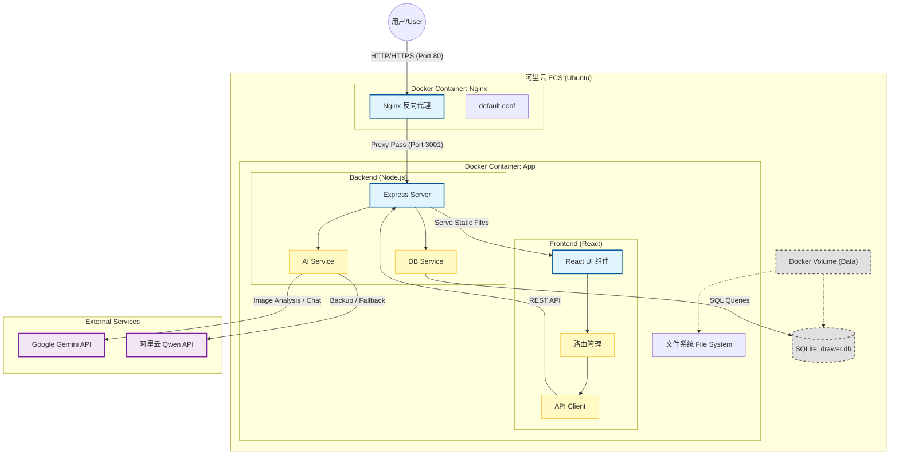

# 技术架构图 (Architecture Diagram)

## 架构说明

1.  **接入层**: 用户请求首先到达运行在 Docker 中的 **Nginx**，Nginx 负责静态资源缓存配置、请求转发以及端口映射（80 -> 3001）。
2.  **应用层**:
    *   **前端**: React 构建的 SPA (单页应用)，通过 REST API 与后端通信。
    *   **后端**: Express 服务器，负责业务逻辑处理、AI 接口聚合以及数据库操作。
3.  **数据层**: 使用 **SQLite** 本地数据库，通过 Docker Volume 挂载到宿主机，确保持久化存储。
4.  **外部服务**: 集成了 Google Gemini 和 阿里云 Qwen 大模型，用于图片理解和智能对话。
